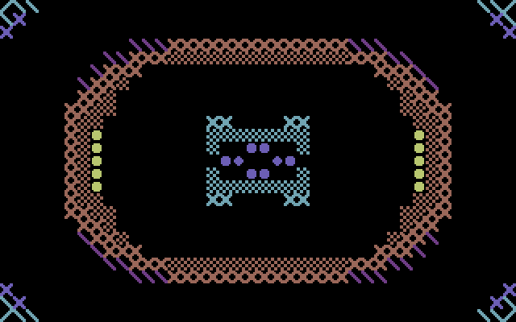
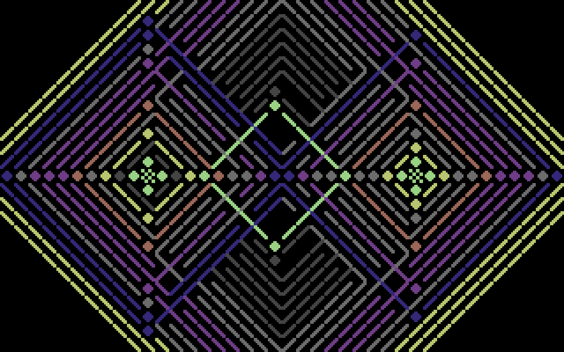

# PETSCII / 64

**Your music, in C64 colours.** A free Linux music visualiser inspired by
Atari Video Music, PETSCII graphics, and the Commodore 64's 16-colour palette.



Play music in **cliamp, Spotify, a browser, or any other player**. PETSCII / 64
listens to your system audio and turns it into mirrored character patterns.
No music account, player plugin, or microphone required.

- **Kaleidoscope:** mirrored, flowing patterns driven by frequency bands.
- **Diamonds:** stereo shapes, colour movement, and expanding pulse rings.
- **Spectrum:** a symmetric tapestry of PETSCII-inspired characters.
- Crisp 40×25 character graphics and the 16-colour VIC-II palette.
- Fullscreen, character trails, colour cycling, and adjustable sensitivity.
- Controls and cursor disappear after two seconds; move the mouse or press a key
  to bring them back.




## Install on Linux

You need **Python 3.12 or newer**, Git, and a working PipeWire-Pulse or PulseAudio
desktop audio session. Tested on Omarchy / Arch Linux.

On **Omarchy**:

```bash
omarchy pkg add python git libpulse
```

On **Arch Linux**:

```bash
sudo pacman -S --needed python git libpulse
```

On **Ubuntu 24.04 or newer**:

```bash
sudo apt install python3 python3-venv git pulseaudio-utils
```

Then download and install:

```bash
git clone https://github.com/caderbyshire/petscii-64.git
cd petscii-64
./install.sh
```

The installer creates an isolated Python environment in the project and adds
**PETSCII / 64** to your app menu. It does not install system packages or need sudo.
Keep the downloaded project folder in place: the launcher points to it.

Open **PETSCII / 64** from your app menu, or run:

```bash
./run
```

If `~/.local/bin` is on your PATH, you can also use `petscii-64`.
Start your music, press **F** for fullscreen, and enjoy. Kaleidoscope is the default.
For a preview without music, use `./run --demo`.

## Keys

| Key | Action |
| --- | --- |
| 1 / 2 / 3 | Diamonds / spectrum / kaleidoscope |
| C | Cycle colours |
| T | Toggle trails |
| + / − | Increase / decrease input sensitivity |
| Space | Freeze / resume |
| F | Fullscreen |
| D | Toggle demo audio |
| R | Reconnect system audio |
| S | Save a screenshot in the project folder |
| ? / H | Show / hide help |
| Q / Escape | Quit |

## Fonts

A redistributable **PETSCII-inspired bitmap font** is included, so there is nothing
else to download. If VICE's original C64 character ROM is already installed,
the app uses that automatically. No Commodore ROM is bundled.

To choose explicitly:

```bash
./run --charset bundled
./run --charset /path/to/c64-chargen.bin
```

The screenshots above use the included fallback. Font attribution is in
[assets/README.md](assets/README.md).

## Troubleshooting

**No movement?** Check that music is playing through your default audio output,
then try `+` to increase sensitivity. Press D to check the graphics with demo audio.

**Changed speakers or headphones?** Press R to reconnect to the new default output.

**Need another output?** Run `pactl list short sources`, then pass a monitor name:

```bash
./run --source YOUR_OUTPUT.monitor
```

The app captures output audio through `parec`. It does not record the microphone,
save captured audio, or send it anywhere. Linux desktop audio is supported in this
release; Windows and macOS capture are not implemented.

## Update or uninstall

To update, close the app, run `git pull` inside the project, then `./install.sh` again.

To remove the launcher:

```bash
rm ~/.local/bin/petscii-64 ~/.local/share/applications/petscii-64.desktop
```

Then delete the downloaded project folder if you no longer want it.

## Development

```bash
SDL_VIDEODRIVER=dummy .venv/bin/python -m unittest discover -s tests -v
SDL_VIDEODRIVER=dummy ./run --demo --charset bundled --frames 150 --screenshot /tmp/preview.png
```

Built with Python, pygame-ce, and NumPy. Released under the [MIT licence](LICENSE).
Found a bug or have an effect idea? [Open an issue](https://github.com/caderbyshire/petscii-64/issues).
